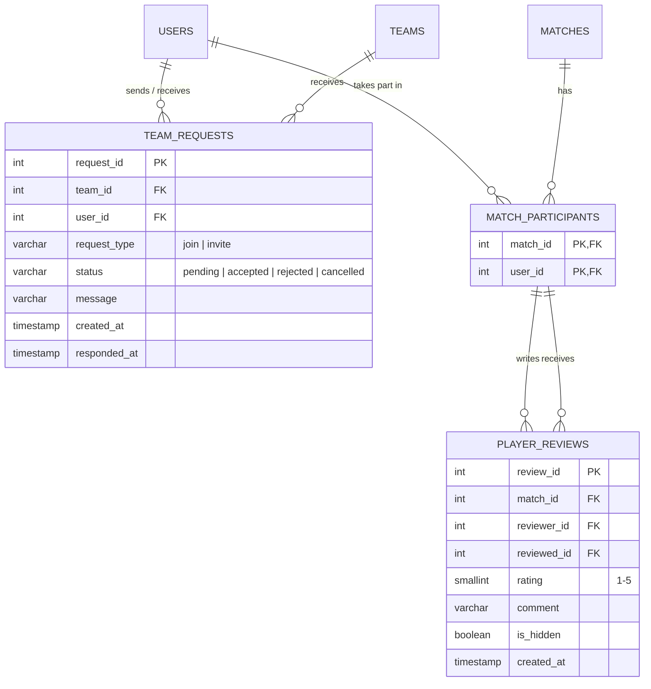

# Milestone 2 — team_requests and player_reviews

**Owner:** Baturalp Taha Yılmaz (150220302)
**Related requirements:** FR-13, FR-14, FR-15, FR-21, NFR-03, NFR-07 (revised proposal, 20 Nov 2026)

## 1. Data Requirements

| ID | Data to store | Rules | Supports |
|---|---|---|---|
| DR-12 | Team requests: the team, the player, whether the player applied (`join`) or the captain invited (`invite`), status, an optional message, when the request was sent and when it was answered or withdrawn | Request type is `join` or `invite`; status is `pending`, `accepted`, `rejected` or `cancelled` (withdrawn by the sender; default `pending`); a pending request has no response time and an answered one always has one, not earlier than the request; a player can have at most one pending request per team; answered and withdrawn requests are kept as history | FR-13, FR-14, NFR-07 |
| DR-13 | Player reviews: the match, the player who gives the review, the player who receives it, a rating, an optional comment, whether an admin has hidden it, and the review date | Rating is 1 (poor) to 5 (excellent); both players must be participants of the same match; a player cannot rate themselves; a player rates another player at most once per match; a review can only be written within 7 days after the match is completed; hidden reviews are not shown and not counted in any average | FR-15, FR-21, NFR-03, NFR-07 |

A player's average rating is **not stored**; it is computed from the visible rows of `player_reviews` (hidden reviews excluded) so it can never become outdated.

## 2. Entities

| Entity | Type | Represents |
|---|---|---|
| `team_requests` | Strong entity (surrogate key) | A join request or an invitation between a team and a player, including its answer |
| `player_reviews` | Strong entity (surrogate key) | A rating that one participant of a match gives another participant of the same match |

## 3. Relational Schema

### team_requests

| Column | Data type | Key / constraints |
|---|---|---|
| request_id | SERIAL | PK |
| team_id | INTEGER | NOT NULL, FK → teams(team_id) ON DELETE CASCADE |
| user_id | INTEGER | NOT NULL, FK → users(user_id) ON DELETE CASCADE |
| request_type | VARCHAR(10) | NOT NULL, CHECK IN ('join', 'invite') |
| status | VARCHAR(10) | NOT NULL, DEFAULT 'pending', CHECK IN ('pending', 'accepted', 'rejected', 'cancelled') |
| message | VARCHAR(300) | NULL |
| created_at | TIMESTAMP | NOT NULL, DEFAULT CURRENT_TIMESTAMP |
| responded_at | TIMESTAMP | NULL |

Table constraints and indexes:

- `CHECK ((status = 'pending') = (responded_at IS NULL))`
- `CHECK (responded_at IS NULL OR responded_at >= created_at)`
- Partial unique index `uq_team_requests_one_pending` ON (team_id, user_id) WHERE status = 'pending'
- Partial index `idx_team_requests_user_pending` ON (user_id) WHERE status = 'pending'

### player_reviews

| Column | Data type | Key / constraints |
|---|---|---|
| review_id | SERIAL | PK |
| match_id | INTEGER | NOT NULL, FK (with reviewer_id and reviewed_id, see below) |
| reviewer_id | INTEGER | NOT NULL |
| reviewed_id | INTEGER | NOT NULL |
| rating | SMALLINT | NOT NULL, CHECK 1–5 |
| comment | VARCHAR(500) | NULL |
| is_hidden | BOOLEAN | NOT NULL, DEFAULT FALSE |
| created_at | TIMESTAMP | NOT NULL, DEFAULT CURRENT_TIMESTAMP |

Table constraints and indexes:

- FK (match_id, reviewer_id) → match_participants(match_id, user_id) ON DELETE CASCADE
- FK (match_id, reviewed_id) → match_participants(match_id, user_id) ON DELETE CASCADE
- `CHECK (reviewer_id <> reviewed_id)`
- `UNIQUE (match_id, reviewer_id, reviewed_id)`
- Partial index `idx_player_reviews_reviewed` ON (reviewed_id) WHERE NOT is_hidden
- Index `idx_player_reviews_reviewer` ON (reviewer_id)

**Design decisions**

- **One table for join requests and invitations.** Both have the same columns and the same life cycle (pending → accepted / rejected / cancelled); only the sender differs. A `request_type` column avoids two almost identical tables and lets a player see all pending requests and invitations with one query. `user_id` is always the player; the captain is found through `teams.captain_id`.
- **Partial unique index instead of UNIQUE (team_id, user_id).** A plain UNIQUE constraint would stop a player from applying again after a rejection, or the old request would have to be deleted and the history lost. The partial index only covers rows with `status = 'pending'`, so any number of answered requests can stay as history while the database still guarantees at most one open request per team and player. It also blocks a pending join request and a pending invitation for the same pair at the same time.
- **Status and response time are checked together.** `(status = 'pending') = (responded_at IS NULL)` makes "accepted without a response time" and "pending with a response time" impossible, and the second CHECK keeps the answer from being earlier than the request. A withdrawal by the sender (FR-14) is stored as `cancelled` with its time in `responded_at`, so it is kept as history like an answer.
- **Reviews reference match_participants, not users.** The two composite foreign keys point to the primary key (match_id, user_id) of `match_participants`, so the database itself guarantees that the reviewer and the reviewed player both took part in that match (NFR-03: invalid states are rejected by constraints). This requires `match_participants` to have the primary key (match_id, user_id), as planned in the proposal.
- **The 7-day review window is checked in the INSERT itself.** A CHECK constraint cannot read `matches`, so the INSERT in Section 5 selects from `matches` and only inserts a row when the match is completed (end time passed, not pending or cancelled) and the end time is at most 7 days ago. If no row is inserted, Flask shows "the review period has ended".
- **Hide instead of delete (FR-21).** An admin sets `is_hidden = TRUE` instead of deleting the review, so the decision can be reversed and the review still blocks a second review of the same pair. Every read and every average filters `NOT is_hidden`. A reviewer's own deletion is a real DELETE, because it is their own content.
- **Rules that need other tables are checked in Flask:** an invitation is only sent by the team's captain, a request is not created for a player who is already a member (the captain is always a member, so this also covers the captain), and only the receiver can accept or reject while only the sender can withdraw. When a request is accepted, the primary key of `team_members` still prevents a double membership.
- **Indexes for frequent filters (NFR-07).** The inbox filters `team_requests` by `user_id` and pending status, the captain's list by `team_id` and pending status (covered by the partial unique index), the player page filters visible reviews by `reviewed_id`, and "my reviews" filters by `reviewer_id`. Partial indexes only contain the rows these pages read, so they stay small.
- **ON DELETE CASCADE:** a request has no meaning without its team or player, and a review has no meaning without the participations it refers to. When a team, user or match (and so its participants) is deleted, the related requests and reviews are removed automatically; this matches FR-02 (the reviews a deleted user wrote and received are deleted).

## 4. Relationships and Cardinalities

| # | Relationship | Cardinality | Implemented as |
|---|---|---|---|
| R1 | A team receives requests | 1:N (a team has 0..* requests; each request belongs to exactly 1 team) | `team_requests.team_id` FK → teams |
| R2 | A user sends or receives requests | 1:N (a user has 0..* requests; each request concerns exactly 1 user) | `team_requests.user_id` FK → users |
| R3 | A match participant writes reviews | 1:N (a participation has 0..* given reviews; each review has exactly 1 reviewer) | FK (match_id, reviewer_id) → match_participants |
| R4 | A match participant receives reviews | 1:N (a participation has 0..* received reviews; each review has exactly 1 reviewed player) | FK (match_id, reviewed_id) → match_participants |

Together, R1 and R2 form an M:N relationship between users and teams over time, with at most one pending request per pair at any moment; accepting a request creates the `team_members` row. R3 and R4 form an M:N "rates" relationship between users, limited to players of the same match and to one review per pair per match.

## 5. CRUD Operations

All queries use parameterized SQL (`%s` placeholders) through psycopg. List pages show 20 rows per page (`LIMIT 20 OFFSET %s`).

| Operation | Page / action | SQL |
|---|---|---|
| Create | Apply to a team | `INSERT INTO team_requests (team_id, user_id, request_type, message) VALUES (%s, %s, 'join', %s) RETURNING request_id;` |
| Create | Invite a player (captain) | `INSERT INTO team_requests (team_id, user_id, request_type, message) VALUES (%s, %s, 'invite', %s) RETURNING request_id;` (Flask first checks that the current user is the team's captain) |
| Read | My pending requests and invitations | `SELECT tr.request_id, t.name, tr.request_type, tr.message, tr.created_at FROM team_requests tr JOIN teams t ON t.team_id = tr.team_id WHERE tr.user_id = %s AND tr.status = 'pending' ORDER BY tr.created_at DESC;` |
| Read | Pending applications to my teams (captain) | `SELECT tr.request_id, t.name, u.username, tr.message, tr.created_at FROM team_requests tr JOIN teams t ON t.team_id = tr.team_id JOIN users u ON u.user_id = tr.user_id WHERE t.captain_id = %s AND tr.request_type = 'join' AND tr.status = 'pending' ORDER BY t.name, tr.created_at;` |
| Update | Accept (receiver) | In **one transaction**: `UPDATE team_requests SET status = 'accepted', responded_at = CURRENT_TIMESTAMP WHERE request_id = %s AND status = 'pending' RETURNING team_id, user_id;` then `INSERT INTO team_members (team_id, user_id) VALUES (%s, %s);` If either statement fails, the whole transaction is rolled back. A join request is accepted by the captain, an invitation by the player. |
| Update | Reject (receiver) | `UPDATE team_requests SET status = 'rejected', responded_at = CURRENT_TIMESTAMP WHERE request_id = %s AND status = 'pending';` |
| Update | Withdraw (sender) | `UPDATE team_requests SET status = 'cancelled', responded_at = CURRENT_TIMESTAMP WHERE request_id = %s AND status = 'pending';` |
| Delete | — | Requests are not deleted by users, so the history is kept; they are removed by CASCADE when the team or the user is deleted |
| Create | Rate a player after a match | `INSERT INTO player_reviews (match_id, reviewer_id, reviewed_id, rating, comment) SELECT m.match_id, %s, %s, %s, %s FROM matches m WHERE m.match_id = %s AND m.status NOT IN ('pending', 'cancelled') AND m.end_time < NOW() AND m.end_time >= NOW() - INTERVAL '7 days';` (0 rows inserted = the match is not completed or the 7 days have passed; the foreign keys reject players who did not take part) |
| Read | A player's reviews | `SELECT u.username, r.rating, r.comment, r.created_at FROM player_reviews r JOIN users u ON u.user_id = r.reviewer_id WHERE r.reviewed_id = %s AND NOT r.is_hidden ORDER BY r.created_at DESC LIMIT 20 OFFSET %s;` |
| Read | A player's average rating | `SELECT COUNT(*), ROUND(AVG(rating), 2) FROM player_reviews WHERE reviewed_id = %s AND NOT is_hidden;` |
| Read | My reviews | `SELECT r.review_id, u.username, r.rating, r.comment, r.created_at FROM player_reviews r JOIN users u ON u.user_id = r.reviewed_id WHERE r.reviewer_id = %s ORDER BY r.created_at DESC LIMIT 20 OFFSET %s;` |
| Update | Edit my review | `UPDATE player_reviews SET rating = %s, comment = %s WHERE review_id = %s AND reviewer_id = %s;` |
| Delete | Delete my review | `DELETE FROM player_reviews WHERE review_id = %s AND reviewer_id = %s;` |
| Read | Moderation list (admin) | `SELECT r.review_id, w.username AS reviewer, d.username AS reviewed, r.rating, r.comment, r.is_hidden, r.created_at FROM player_reviews r JOIN users w ON w.user_id = r.reviewer_id JOIN users d ON d.user_id = r.reviewed_id ORDER BY r.created_at DESC LIMIT 20 OFFSET %s;` |
| Update | Hide or unhide a review (admin, FR-21) | `UPDATE player_reviews SET is_hidden = %s WHERE review_id = %s;` |
| Update | Hide or unhide a message (admin, FR-21) | `UPDATE messages SET is_hidden = %s WHERE message_id = %s;` (the `messages` table is owned by Nurhan Aliyev; FR-21 only changes its `is_hidden` column) |

The `AND status = 'pending'` condition in the update statements makes sure an already answered or withdrawn request is never changed again; the `AND reviewer_id = %s` condition makes sure users can only change their own reviews. Admin actions are only reachable for users with `role = 'admin'`.

## 6. Complex Query — Q-05: Top-rated players

**Purpose:** list, for every sport, the players whose average received rating in that sport is above the average of all ratings given in that sport, excluding hidden reviews (at least 3 visible reviews required). Captains can use it to find good players to invite, and players can see who is rated highly in their sport.
**Techniques:** 5-table join, GROUP BY … HAVING, correlated subquery on the outer group's sport (in SELECT and in HAVING).
**SQL:** `sql/queries/q5_top_rated_players.sql`

## 7. Data Population

Sample data is generated with a Python script using the Faker library (Turkish locale), after users, teams, team members, matches and participants are populated:

- 80 team requests: about 60% join requests and 40% invitations
- Status distribution: about 25% pending, 50% accepted, 20% rejected, 5% withdrawn (`cancelled`); answered requests get a response time 0–7 days after the request
- At most one pending request per team and player; no request for a player who is already a member
- Every accepted request has a matching row in `team_members`
- About 1,450 reviews, created only between two participants of the same completed match, 0–7 days after its end time
- Ratings follow a realistic distribution: most are 3–5; about 40% of reviews have a comment; about 2% are hidden by an admin
